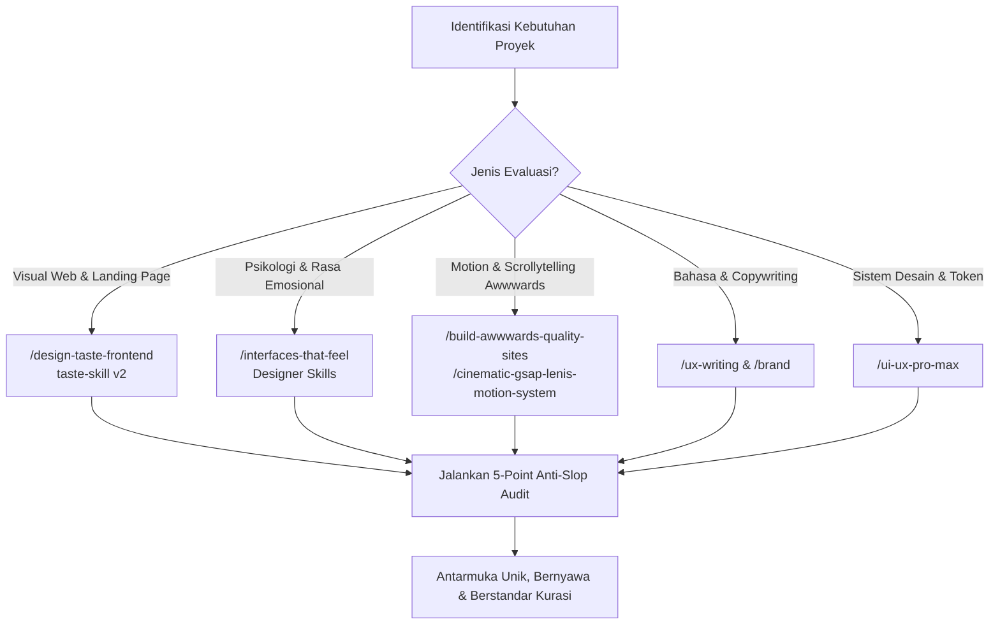

# 🤌 Master Anti-Slop & Taste Orchestrator

Gunakan skill ini setiap kali Anda merancang, mengaudit, membangun ulang (*redesign*), atau memperbaiki halaman web, komponen antarmuka, copywriting, maupun animasi agar terbebas dari penyakit **"AI Slop"** (tampilan generik rata-rata khas AI yang membosankan dan tanpa jiwa).

---

## 🚫 Anatomi "AI Slop" (Yang Dilarang Keras)

Halaman buatan AI default biasanya merefleksikan nilai rata-rata dari miliaran halaman internet yang pernah dilihatnya. Tidak ada yang salah secara fungsional, tetapi **tidak ada satu pun keputusan sadar (*decision*) di dalamnya**.

Hindari pola-pola default berikut:

1. **Visual & Layout Slop:**
   * ❌ Judul hero rata-tengah 3 baris dengan badge berbentuk kapsul (*pill badge*) kecil melayang di atasnya.
   * ❌ Tiga kartu (*3-column card grid*) seragam dengan ikon warna-warni di dalam kotak beradius membulat ekstrem.
   * ❌ Latar belakang gelap dengan bintik-bintik gradien ungu/biru neon (*generic dark SaaS look*).
   * ❌ Garis tepi pembatas tipis (*1px subtle border*) dan efek blur kaca (*glassmorphism*) di semua elemen tanpa fungsi hierarki.
2. **Copywriting Slop:**
   * ❌ Menggunakan kata klise: *"Transform your workflow"*, *"Supercharge your productivity"*, *"Harness the power of AI"*, *"Seamlessly integrate"*, *"Delve"*, *"Testament"*.
   * ❌ Teks deskripsi hambar yang tidak menyebut fakta atau angka spesifik tentang produk/klien.
3. **Motion & Interaction Slop:**
   * ❌ Animasi linear kaku tanpa bobot inersia (*float effect* tanpa tujuan).
   * ❌ Fade-in serentak dengan delay acak yang membuat pengguna harus menunggu sebelum membaca konten.
   * ❌ Hover efek yang hanya membesarkan tombol secara murahan (*scale: 1.05*).
4. **Code & Structural Slop:**
   * ❌ Kode monolitik tanpa modularitas, variabel warna acak hex hard-coded tanpa token semantik HSL/CSS variables.
   * ❌ Mock data palsu (*lorem ipsum*, angka acak 100k, rating 5.0 bintang palsu).

---

## 🛠️ Matriks Transformasi: Slop vs Human Craft

| Elemen Antarmuka | AI Slop Default ❌ | Human Craft & Curated Taste ✅ |
| :--- | :--- | :--- |
| **Hero Section** | Header tengah, teks abu-abu, 2 tombol simetris, badge pil | Asimetris, tipografi display berani, proposisi nilai konkret, foto subjek nyata |
| **Hierarki & Konten** | Kotak-kotak seragam berisi ikon abstrak | Grid majalah (*editorial typography*), ritme kontras skala, whitespace bermakna |
| **Palet Warna** | Indigo/Cyan neon (`#6366f1` / `#06b6d4`) | Palet terkurasi sesuai psikologi industri (tonal bumi, warm monochrome, kontras tajam) |
| **Microcopy** | *"Get started today for free"* | *"Coba 14 hari tanpa kartu kredit. Data Anda tidak dijual."* (Jujur & faktual) |
| **Animasi** | `transition: all 0.3s ease` seragam | Fisika pegas nyata (*spring physics*), easing out natural, micro-interaction bernyawa |
| **Loading & Error** | Spinner memutar dingin | Copy tenang yang menenangkan pengguna, jeda pemulihan 300–600ms, tanpa menyalahkan |

---

## 🧭 Alur Kerja Orkestrasi Sub-Skills Anti-Slop

Saat `/anti-slop` diaktifkan, pilih jalur orkestrasi yang sesuai dengan kebutuhan:

### 1. Jalur Visual & Art Direction (Website & Landing Page)
* Panggil **`/design-taste-frontend`**: Ambil inspirasi dari katalog 247 situs Awwwards & One Page Love. Gali 8–12 identitas unik klien (alamat, material fisik, ritme produksi).
* Pilih varian estetika berkarakter:
  * `/minimalist-ui`: Tampilan editorial monokrom hangat.
  * `/industrial-brutalist-ui`: Tipografi Swiss tegas, fungsional tanpa basa-basi.
  * `/high-end-visual-design`: Kontras lembut dan kemewahan yang tenang.

### 2. Jalur Sentuhan Emosional (*Emotional Resonance*)
* Panggil **`/interfaces-that-feel`**: Berikan bobot fisik pada antarmuka. Pastikan ada jeda 300–600ms setelah error agar pengguna tidak panik, jangan mempermalukan pengguna atas kegagalan sistem, dan sesuaikan suasana loading dengan bobot data yang diambil.

### 3. Jalur Gerak & Scrollytelling
* Panggil **`/build-awwwards-quality-sites`** dan **`/cinematic-gsap-lenis-motion-system`**: Integrasikan smooth scroll berbasis Lenis dan timeline GSAP terkoordinasi untuk membangun penceritaan visual yang imersif.

### 4. Jalur Copywriting Bebas Basa-Basi
* Panggil **`/ux-writing`**: Ganti seluruh teks template dengan kalimat manusiawi. Tuliskan batas konkret: berapa menit pesanan selesai, material apa yang dipakai, siapa pendirinya, dan apa jaminannya.

---

## 📋 5-Point Anti-Slop Juror Checklist

Sebelum menyerahkan desain atau kode kepada pengguna, lakukan verifikasi mandiri berikut:

- [ ] **1. Grounded in Reality:** Apakah konsep ini berakar dari fakta nyata subjek (bukan ide generik kategori software/toko)?
- [ ] **2. Zero Meaningless Ornaments:** Apakah badge melayang, floating gradient, atau kartu berikon dihilangkan jika tidak menambah kejelasan?
- [ ] **3. Editorial Typographic Hierarchy:** Apakah ukuran judul utama memiliki skala kontras yang berani (misal `clamp(2.5rem, 5vw, 5rem)`) terhadap teks body?
- [ ] **4. Honest & Human Copy:** Apakah teks terasa seperti obrolan orang sungguhan dan bebas dari buzzwords korporat AI?
- [ ] **5. Intentional Motion:** Apakah setiap transisi memiliki bobot dan waktu redaman natural, bukan sekadar animasi lewat?

