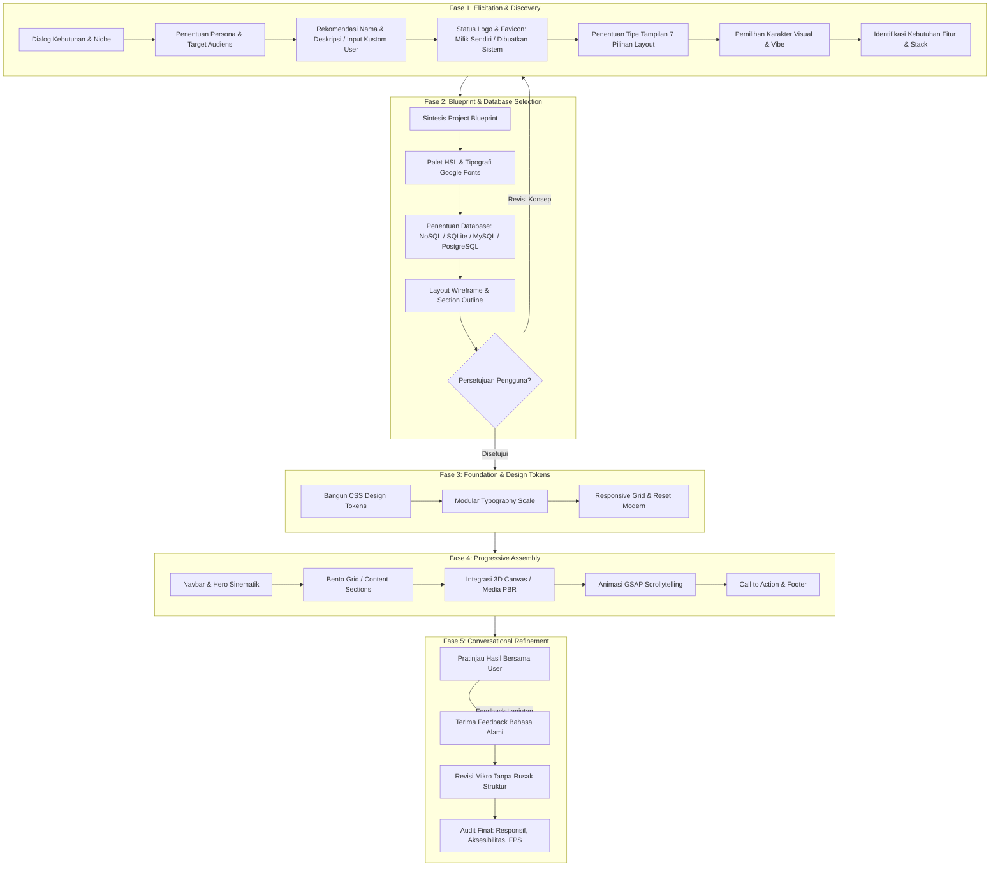

# 🌐 WebBuilder: Conversational Web Creation Framework

> **Kerangka Konseptual & Arsitektur Pembuatan Website Otomatis Berbasis Metode Dialog Percakapan (Sistem ⇄ Pengguna)**

---

## 📖 1. Latar Belakang & Filosofi

Sebagian besar generator web otomatis berbasis AI gagal menghasilkan website yang memukau karena menerapkan metode **"One-Shot Generation"** (membuat seluruh kode dari satu prompt singkat). Pendekatan ini sering menghasilkan desain generik (*AI slop*), tata letak kaku, warna tidak harmonis, dan tidak sesuai dengan visi asli pengguna.

**WebBuilder** mengadopsi pendekatan **"Iterative Conversational Co-Creation"**:
- **Sistem AI** berperan sebagai **Lead Web Architect & Creative Director**.
- **Pengguna** berperan sebagai **Product Owner & Visionary**.
- Website dibangun secara kolaboratif melalui **dialog terarah**, di mana sistem secara cerdas menggali kebutuhan, menawarkan alternatif desain, menyusun fondasi token, merakit komponen per section, dan menyempurnakannya melalui iterasi percakapan langsung.

---

## 🧭 2. Arsitektur 5 Tahapan Siklus Hidup (Life-Cycle Framework)



---

## 💬 3. Protokol Wawancara Percakapan (Conversational Dialogue Protocol)

Agar percakapan tidak melelahkan pengguna, sistem tidak melontarkan puluhan pertanyaan sekaligus, melainkan menggunakan metode **Chunked Guided Inquiry** (3-4 pertanyaan kunci per putaran) dengan opsi rekomendasi yang jelas.

### Putaran 1: Identitas, Persona, Nama, Logo, Favicon & Tipe Tampilan
`nCatatan: daftar dan urutan di bawah adalah bahan referensi. Ajukan hanya pertanyaan yang belum terjawab, maksimal tiga pertanyaan per giliran; untuk perubahan kecil jangan jalankan wawancara penuh.
1. **Jenis & Niche**: *"Website apa yang ingin kita bangun? (Contoh: Landing Page Produk, Profil Daerah/Pariwisata, Portofolio Kreatif, SaaS Dashboard, atau Profil Bisnis?)"*
2. **Audiens Utama & Persona**: *"Siapa target pengunjung website ini? (Masyarakat umum, calon investor, turis lokal/asing, atau profesional?)"*
3. **Rekomendasi Nama & Deskripsi Website (Brand Identity)**:
   Berdasarkan niche, persona, dan target audiens yang baru dipilih, sistem secara otomatis meracik **3 Alternatif Rekomendasi Nama & Tagline/Deskripsi**, atau pengguna dapat **mengisi nama & deskripsinya sendiri**:
   - 💡 **Opsi A (Modern & Catchy)**: Nama ringkas dan berdaya ingat tinggi (contoh: *"MinselScape — Living Highlands & Heritage"*).
   - 🏛️ **Opsi B (Resmi & Kredibel)**: Nama deskriptif formal (contoh: *"Pesona Minsel — Portal Resmi Eksplorasi Wisata & Budaya"*).
   - 🌟 **Opsi C (Action & Story-Driven)**: Nama yang mengajak aksi emosional (contoh: *"Discover Minahasa Selatan — Jelajahi Keajaiban Alam Bumi Malesung"*).
   - ✍️ **Opsi D (Input Kustom Pengguna)**: Pengguna bebas memasukkan nama website dan tagline/deskripsi sendiri jika sudah memiliki brand paten.
4. **Kepemilikan Logo & Favicon**:
   Sistem menanyakan kesiapan aset visual identitas:
   - 📁 **Opsi A (Milik Sendiri / Existing Assets)**: Pengguna menyediakan file logo (`logo.svg` / `logo.png`) dan favicon (`favicon.ico` / `favicon.svg`) di folder proyek.
   - ✨ **Opsi B (Sistem Bantu Buatkan Otomatis)**: Jika pengguna belum memiliki logo/favicon, sistem akan otomatis:
     - Merancang **Modern Vector Logo (SVG)** berbasis kode murni (tajam di semua resolusi, ringan, dan selaras dengan tema website).
     - Menghasilkan `favicon.svg`; fallback PNG/ICO dan apple-touch icon perlu dibuat terpisah bila dibutuhkan.
5. **Tindakan Kunci (Primary CTA)**: *"Apa yang Anda ingin pengunjung lakukan saat membuka web? (Menghubungi via WhatsApp, reservasi, unduh panduan, atau mulai eksplorasi?)"*
6. **Tipe Tampilan Website (Layout & Presentation Paradigm)**:
   Sistem memaparkan matriks 7 tipe tampilan standar industri berikut agar pengguna dapat memilih arsitektur layout yang paling tepat:

| No | Tipe Tampilan | Karakteristik Utama | Contoh Penggunaan / Website Terkait |
| :-: | :--- | :--- | :--- |
| **1** | **Single-Page** | Konten dimuat dalam satu halaman panjang, pengguna melakukan scroll ke bawah, dilengkapi menu navigasi yang melompat ke bagian tertentu (*sticky anchor*). | Cocok untuk portofolio, landing page produk, kampanye destinasi wisata. |
| **2** | **Multi-Page** | Terbagi ke dalam beberapa halaman terpisah yang terhubung lewat menu navigasi (Beranda, Layanan/Destinasi, Tentang, Kontak). | Cocok untuk company profile, e-commerce, portal resmi daerah. |
| **3** | **Responsive Design** | Desain website otomatis menyesuaikan ukuran layar perangkat (komputer desktop, tablet, smartphone) secara fleksibel. | Standar wajib untuk hampir semua website modern. |
| **4** | **Card-Based** | Konten disusun dalam bentuk kotak-kotak/kartu terpisah (*bento grid / card layout*) berisi gambar, judul, dan teks ringkas yang interaktif. | Cocok untuk galeri, portofolio, katalog fitur, Pinterest-style. |
| **5** | **Grid-Heavy / Magazine Style** | Memuat banyak informasi/artikel dalam kolom kotak padat mirip surat kabar atau majalah digital. | Cocok untuk portal berita daerah, majalah online, publikasi media. |
| **6** | **Fullscreen / Immersive** | Memaksimalkan visual dengan gambar besar, video sinematik, atau canvas 3D/animasi yang memenuhi layar penuh (*viewport*). | Cocok untuk agensi kreatif, hotel mewah, fashion, pameran virtual. |
| **7** | **Dashboard / App-Like** | Menyerupai aplikasi perangkat lunak (*app shell*) dengan menu sidebar dan area utama dinamis untuk grafik/data. | Cocok untuk SaaS, panel admin, aplikasi perbankan, portal mandiri. |

### Putaran 2: Karakter Estetika & Emosi Visual
Sistem merekomendasikan 3 gaya yang paling cocok berdasarkan profil industri (terintegrasi dengan keahlian `/ui-ux`):
- **Gaya A: Dark Modern Luxury / Glassmorphism** (Eksklusif, latar gelap dalam, kartu kaca buram, aksen glow).
- **Gaya B: Bento Grid Minimalist** (Rapi, modular, putih/abu bersih, struktur informasi sangat teratur).
- **Gaya C: Immersive Nature / 3D Cinematic** (Segar, warna alam hidup, canvas 3D interaktif, foto bertekstur nyata).

### Putaran 3: Rekomendasi Tech Stack & Pemilihan Database (Fase 2)
Sistem menanyakan dan menyepakati kebutuhan stack komputasi serta persistensi data website. WebBuilder didukung oleh **[Master Matriks 545 Teknologi Web](references/tech_stack_matrix.md)** untuk memberikan rekomendasi stack terbaik sesuai kasus penggunaan:

#### 🎯 Rekomendasi Stack Berdasarkan Arketipe Proyek:
| Arketipe Proyek | Rekomendasi Stack | Karakteristik & Pertimbangan |
| :--- | :--- | :--- |
| **Portal Pemerintah / CMS** | **CodeIgniter 4** / **Laravel** + **Bootstrap 5** / **Tailwind** + WYSIWYG + Modul SEO + Audit Log | Ringan, aman, mudah dikelola tim PHP lokal, biaya hosting ekonomis, integrasi langsung `/ci4` & `/security`. |
| **Portal Modern Berbasis API** | **Laravel** / **FastAPI** + **Vue 3** (Composition API) + **TypeScript** + **PostgreSQL** / **MySQL** | Pemisahan tegas frontend/backend, reaktivitas tinggi, tipe data aman dengan `/vue` & `/nuxt`. |
| **AI Assistant / RAG Platform** | **FastAPI** + **Vue 3** / **Streamlit** + **PostgreSQL (pgvector)** + Worker Queue | Caching interaktif, pemisahan retrieval dokumen, dan antarmuka percakapan ramah pengguna. |
| **Enterprise .NET** | **ASP.NET Core** + **Blazor** / **Angular** / **React** + **SQL Server** / **PostgreSQL** | Standar korporat skala besar, ekosistem Microsoft, kontrol keamanan dan tata kelola enterprise ketat. |
| **Aplikasi Java Enterprise** | **Spring Boot** + **Angular** / **React** / **Vue** + **PostgreSQL** / **Oracle** | Stabilitas tinggi transaksi perbankan/finansial, arsitektur microservices JVM matang. |
| **Situs Statis / Dokumentasi** | **Astro** / **Hugo** / **11ty** + Headless CMS (Decap / Strapi) | Waktu muat ultra cepat (0ms JS by default), skor Core Web Vitals 100, hosting edge gratis. |
| **E-Commerce & Transaksional** | **WooCommerce**, **Medusa.js**, **Saleor**, **Shopware**, atau Shopify SaaS | Integrasi payment gateway lokal (QRIS, VA), kontrol inventaris multi-cabang, dan audit transaksi. |

#### 🗄️ Matriks Pemilihan Database Utama:
| No | Tipe Database | Karakteristik Utama | Rekomendasi Kasus Penggunaan | Sinergi Stack / Skill |
| :-: | :--- | :--- | :--- | :--- |
| **1** | **NoSQL** *(MongoDB / Firebase / CouchDB / KV)* | Fleksibel tanpa skema kaku (*schema-less*), penyimpanan dokumen JSON hierarkis, replikasi horizontal mudah. | Real-time chat, katalog produk dengan atribut dinamis, log aktivitas pengguna, formulir survei bebas. | `/vue` / Node.js (Mongoose / Firebase SDK) |
| **2** | **SQLite** | *Serverless*, *zero-configuration*, database berbasis satu file lokal (`.sqlite3` / `.db`), cepat, sangat ringan dan portabel. | Prototipe cepat (MVP), website lokal/desktop, dashboard personal, edge runtime (NuxtHub / Cloudflare D1 / Turso). | `/vue` + `/nuxt` (Drizzle ORM) atau Python |
| **3** | **MySQL / MariaDB** | Standar industri relasional (RDBMS), performa kueri relasi tinggi, transaksi ACID ketat, kompatibilitas hosting terluas. | Aplikasi web korporat, e-commerce konvensional, portal instansi pemerintah, sistem manajemen relasional. | `/ci4` (CodeIgniter 4 Model, Query Builder & Shield) |
| **4** | **PostgreSQL** | RDBMS tingkat lanjut (*object-relational*), mendukung kueri kompleks, JSONB indexing super cepat, geospasial (PostGIS). | Platform SaaS modern, sistem analitik data, portal skala enterprise, cloud database modern (Supabase / Neon). | `/ci4` atau `/vue` (Prisma / Supabase SDK) |
| **5** | **None / Static Web** | Tanpa database backend; seluruh konten dikelola langsung di file HTML/JSON statis. | Landing page presentasi, company profile statis, web portofolio personal. | `/web-builder` murni |

*(Lihat katalog lengkap 545 teknologi, framework, dan tools di **[tech_stack_matrix.md](references/tech_stack_matrix.md)**)*


### Putaran 4: Pemilihan Fitur & Integrasi Spesifik (Katalog 55 Fitur)
Sistem tidak membiarkan pengguna bingung meraba-raba fitur apa saja yang mungkin dibutuhkan. Sistem mengelompokkan **Katalog 55 Fitur Standar Industri** menjadi 6 Klaster Cerdas, atau pengguna dapat langsung memilih nomor fitur tertentu (misal: *"Saya ingin fitur 1, 2, 4, 8, 16, 21, 22, 47"*):

1. **Klaster A: UI/UX, Visual & Interaksi Mikro** (Fitur #1, #2, #4, #7, #8, #9, #10, #16, #51)
2. **Klaster B: Visualisasi Data & Berkas** (Fitur #5, #11, #13, #15, #40, #55)
3. **Klaster C: Autentikasi, Pengguna & Keamanan** (Fitur #6, #12, #18, #23, #25, #35, #39, #49, #52, #54)
4. **Klaster D: Konten, Publikasi & Bahasa** (Fitur #26, #27, #31, #32, #43)
5. **Klaster E: Komunikasi, Notifikasi & Asisten AI** (Fitur #3, #14, #34, #47, #48, #50, #53)
6. **Klaster F: Arsitektur Backend, Performa & DevOps** (Fitur #17, #19, #20, #21, #22, #24, #28, #29, #30, #33, #36, #37, #38, #41, #42, #44, #45, #46)

---

### Mode Situs dan Kebutuhan Dashboard

- **Statis / pasif**: konten utama jarang berubah dan halaman dapat disajikan tanpa backend khusus.
- **Dinamis / data-driven**: konten atau data berubah, atau pengguna mengirim data, masuk akun, dan memakai integrasi backend/API.
- **Dashboard admin**: panel internal untuk mengelola konten, pengguna, transaksi, atau data. Ini keputusan terpisah: situs dinamis tidak selalu membutuhkan dashboard, sedangkan dashboard admin memerlukan autentikasi dan backend yang sesuai.
- **Dashboard / App-Like** pada pilihan tipe tampilan berarti gaya antarmuka aplikasi; itu tidak otomatis berarti panel admin.

Scaffolder dapat mencatat pilihan tersebut lewat `--site-mode static|dynamic` dan `--dashboard yes|no`. Nilainya hanya rencana dalam blueprint; scaffold tidak membangun backend atau dashboard admin.

## 📋 4. Dokumen Standar: The Project Blueprint

Sebelum kode dieksekusi, sistem wajib memaparkan **Blueprint Singkat** dalam format markdown yang merangkum hasil dialog:

```markdown
### 📐 Project Blueprint: [Nama Website]
- **Nama Website**: MinselScape / Pesona Minsel (Pilihan Rekomendasi AI atau Input Kustom Pengguna)
- **Tagline / Meta Deskripsi**: "The Living Volcanic Highlands — Eksplorasi Keindahan Alam & Warisan Leluhur"
- **Logo & Favicon**: Logo SVG dan favicon SVG sederhana dari scaffolder
- **Niche & Tujuan**: Profil Interaktif Pariwisata Minahasa Selatan
- **Tipe Tampilan**: One-Page Scrollytelling (Alur linear berbabak dengan sticky anchor)
- **Mode Situs**: Dinamis (konten/data dapat berubah; kebutuhan backend ditentukan terpisah)
- **Dashboard Admin**: Tidak direncanakan untuk contoh ini
- **Database**: PostgreSQL (Supabase cloud / lokal) - Tabel: `destinations`, `visitor_inquiries`, `events`
- **Fitur yang direncanakan (belum tentu diimplementasikan)**: 
  - #1 Notifikasi & Alert Modern
  - #2 Peta & Lokasi Interaktif (Leaflet / Mapbox)
  - #4 Live Chat & WhatsApp Button
  - #8 Animasi & Efek Visual GSAP
  - #9 Search & Filter Kategori Destinasi
  - #16 Dark Mode & Light Mode Toggle
  - #21 Optimasi Performa & Core Web Vitals
  - #22 Aksesibilitas WCAG AA
  - #47 Integrasi Chatbot Asisten Pariwisata AI
- **Target Audiens**: Wisatawan lokal & internasional, pencinta alam, investor
- **Visual Personality**: *Vibrant Nature with High-End Glassmorphism*
- **Palet Warna**:
  - Background: `hsl(220, 25%, 8%)` (Deep Volcanic Dark)
  - Surface: `hsla(220, 20%, 14%, 0.7)` (Frosted Glass)
  - Primary Accent: `hsl(150, 80%, 42%)` (Tropical Lush Green)
  - Secondary Glow: `hsl(210, 95%, 58%)` (Clear Lake Azure)
- **Tipografi**:
  - Headings: `Outfit` (Bold, Modern geometric)
  - Body: `Inter` (Sangat mudah dibaca pada layar digital)
- **Struktur Halaman (Sections)**:
  1. Sticky Glassmorphic Navbar dengan brand mark & logo
  2. Hero Section dengan ambient 3D lake particles & headline kuat
  3. Interactive Bento Grid: 4 Pilar Wisata & Budaya
  4. 3D Texture Showcase: Batuan Waruga & Alam vulkanik
  5. Interactive Scrollytelling: Penjelajahan Chapter Destinasi
  6. Peta Lokasi Interaktif & Panduan Akomodasi
  7. Chatbot AI Asisten Wisata
  8. Call to Action & Footer informasi kontak
```

---

## 🧩 5. Master Katalog 55 Fitur & Integrasi WebBuilder

Berikut adalah daftar lengkap 55 kapabilitas integrasi dan fitur yang dapat diorkestrasi oleh WebBuilder secara terstruktur:

| No | Jenis Integrasi / Fitur | Fungsi Utama | Sinergi Skill / Modul |
| :-: | :--- | :--- | :--- |
| **1** | **Notifikasi & Alert** | Mengganti alert bawaan browser dengan pesan sukses, peringatan, atau error modern (*toast / snackbar*). | `/ui-ux` |
| **2** | **Peta & Lokasi** | Menampilkan peta interaktif (Leaflet / Google Maps / Mapbox) dengan custom pin marker dan rute. | Frontend Component |
| **3** | **Gerbang Pembayaran** | Memproses pembayaran online melalui transfer bank, e-wallet, QRIS, kartu kredit (Midtrans/Stripe). | `/ci4` / Backend API |
| **4** | **Live Chat & Layanan Pelanggan** | Menghubungkan pengunjung dengan petugas/admin melalui widget live chat atau tombol WhatsApp. | Frontend Widget |
| **5** | **Grafik & Visualisasi Data** | Mengubah data database/JSON menjadi grafik batang, garis, atau pie interaktif (Chart.js / ApexCharts). | Data Visualization |
| **6** | **Manajemen Formulir & Anti-Spam** | Mengelola formulir kontak dengan validasi real-time, honeypot, dan proteksi anti-spam reCAPTCHA/Turnstile. | `/security` |
| **7** | **Integrasi Media Sosial** | Menyediakan tombol berbagi (*share buttons*), tautan feed media sosial, dan meta kartu preview OpenGraph. | Frontend Component |
| **8** | **Animasi & Efek Visual** | Menambahkan transisi halus, animasi saat scroll, parallax, dan efek interaktif mikro. | `/gsap` + `/motion` |
| **9** | **Search, Filter & Sorting** | Fitur pencarian instan, penyaringan kategori (*faceted filter*), dan pengurutan data secara real-time. | Frontend Component |
| **10** | **Breadcrumb & Pagination** | Menunjukkan posisi hierarki halaman pengguna (*breadcrumbs*) dan membagi daftar data panjang menjadi halaman. | UX Navigation |
| **11** | **Grafik Dinamis & Statistik Otomatis** | Memperbarui grafik secara otomatis berbasis data riil database tanpa reload halaman. | Data + Backend |
| **12** | **Autentikasi Lanjutan & MFA** | Menambahkan autentikasi ganda (MFA / 2FA), verifikasi OTP via email/SMS, dan WebAuthn. | `/security` + `/ci4` |
| **13** | **Ekspor & Impor Data** | Menghasilkan laporan PDF/Excel siap unduh dan menerima impor data massal dari file CSV/Excel dengan validasi. | Backend Service |
| **14** | **Notifikasi Real-Time & Push** | Mengirim pemberitahuan instan tanpa refresh halaman (WebSocket/SSE) serta web push notification. | Realtime Hub |
| **15** | **Manajemen File, Uploader & Cropper** | Fitur unggah file/foto dengan drag-and-drop, validasi ukuran/format, dan pemotong gambar (*image cropper*). | Media Manager |
| **16** | **Dark Mode & Light Mode** | Memungkinkan pengguna memilih tema tampilan gelap/terang sesuai preferensi atau pengaturan sistem OS. | `/ui-ux` Design Tokens |
| **17** | **SEO & Open Graph Otomatis** | Mengatur meta title, deskripsi dinamis, dan kartu preview sosial media untuk visibilitas mesin pencari. | `/nuxt-seo` / SEO Helper |
| **18** | **Manajemen Akun & Akses Khusus** | Mengelola login pengguna, hak akses bertingkat (*Role-Based Access Control - RBAC*), dan proteksi rute. | `/ci4-shield` / Auth |
| **19** | **SEO Teknis** | Mengelola file sitemap.xml otomatis, robots.txt, tag kanonikal, dan optimasi struktur URL. | SEO Technical |
| **20** | **Structured Data & Schema.org** | Menyediakan markup data terstruktur JSON-LD agar mesin pencari mengenali jenis konten secara cerdas. | SEO Schema |
| **21** | **Optimasi Performa & Core Web Vitals** | Mempercepat pemuatan halaman dengan kompresi WebP, minifikasi skrip, lazy-loading, dan optimasi LCP/CLS. | `/web-builder` Core |
| **22** | **Aksesibilitas Website (WCAG)** | Mendukung navigasi keyboard penuh, kontras warna rasio tinggi, ARIA labels, dan standar WCAG AA. | `/ui-ux` WCAG Engine |
| **23** | **Keamanan Aplikasi Web** | Melindungi website dari celah XSS, CSRF, SQL Injection, Clickjacking, dan menegakkan header CSP. | `/security` OWASP |
| **24** | **Backup & Disaster Recovery** | Sistem pencadangan database dan berkas unggahan otomatis secara berkala serta pemulihan darurat. | DevOps Maintenance |
| **25** | **Audit Log & Riwayat Aktivitas** | Mencatat log riwayat login, perubahan data penting, dan jejak audit aktivitas pengguna untuk akuntabilitas. | `/security` Audit |
| **26** | **CMS & Manajemen Konten** | Mengelola artikel, halaman statis, banner, dan berita secara dinamis melalui antarmuka admin yang ramah. | Content Engine |
| **27** | **Workflow Persetujuan & Publikasi** | Mengatur alur penerbitan konten bertingkat: draf, pengajuan peninjauan (*review*), dan rilis terjadwal. | Content Workflow |
| **28** | **Progressive Web App (PWA)** | Mendukung instalasi website layaknya aplikasi di ponsel/komputer, ikon homescreen, dan offline mode dasar. | PWA Service Worker |
| **29** | **Analytics & Monitoring** | Mengukur trafik pengunjung, durasi kunjungan, halaman terpopuler, serta memantau error sistem real-time. | Telemetry & Analytics |
| **30** | **Cache & Optimasi API** | Mengurangi beban server dan mempercepat respon data dengan caching memori (Redis / HTTP Cache-Control). | Performance Cache |
| **31** | **Manajemen Konfigurasi Website** | Mengelola pengaturan umum (nama situs, logo, kontak, jam operasional) dari satu panel terpusat. | Site Settings |
| **32** | **Multi-Bahasa & Internasionalisasi** | Menyediakan terjemahan konten ke dalam beberapa bahasa (i18n) dengan pendeteksi otomatis dan URL rapi. | Internationalization |
| **33** | **Pencarian Global & Full-Text Search** | Mesin pencari cepat yang mampu menemukan dokumen, artikel, atau produk lintas database dengan koreksi typo. | Search Engine |
| **34** | **Email Transaksional** | Mengirim email konfirmasi pendaftaran, reset password, dan notifikasi transaksi via SMTP/API profesional. | Email Service |
| **35** | **Privasi, Cookie & Persetujuan** | Menampilkan spanduk persetujuan cookie (*cookie consent*), kebijakan privasi, dan kepatuhan GDPR/regulasi. | Legal Compliance |
| **36** | **REST API & Webhook Eksternal** | Menyediakan endpoint data JSON berstandar RESTful dan pengirim webhook untuk integrasi pihak ketiga. | `/ci4-api` |
| **37** | **Error Handling & Halaman Sistem** | Menampilkan halaman khusus bermerek (*branded error pages*) saat terjadi error 404, 403, dan 500. | System Pages |
| **38** | **Deployment, CI/CD & Version Control** | Konfigurasi alur rilis otomatis via Git, GitHub Actions, dan skrip penyebaran ke hosting/cloud. | DevOps Workflow |
| **39** | **Manajemen Pengguna & Organisasi** | Mengelola profil akun pengguna, informasi biodata, pengaturan kata sandi, dan pengelompokan divisi kerja. | User Management |
| **40** | **Manajemen Dokumen & Arsip Digital** | Repositori dokumen publik/internal (PDF, SK, Perda, Laporan) dengan pencarian nomor surat dan metadata. | Document Archive |
| **41** | **Penjadwalan Tugas Otomatis** | Menjalankan proses latar belakang otomatis (cron jobs) untuk publikasi terjadwal, pengingat, dan pembersihan. | Task Scheduler |
| **42** | **Queue & Background Jobs** | Memproses tugas berat (seperti konversi file, email massal) di antrean pekerja agar website tetap responsif. | Queue Worker |
| **43** | **Manajemen Menu & Navigasi Dinamis** | Mengatur struktur menu header, sub-menu bertingkat (*dropdown*), dan tautan footer langsung dari admin. | Navigation Builder |
| **44** | **Pengelolaan API Documentation** | Menghasilkan dokumentasi interaktif endpoint API secara otomatis menggunakan standar Swagger / OpenAPI. | API Docs |
| **45** | **Pengujian Otomatis & QA** | Skrip pengujian otomatis (Unit Test & E2E Testing) untuk memastikan tidak ada fitur atau form yang rusak. | Testing Suite |
| **46** | **Lingkungan Staging & Produksi** | Pemisahan konfigurasi environment (.env) antara server pengembangan (staging) dan server produksi aktif. | Environment Config |
| **47** | **Integrasi AI Assistant & Chatbot** | Menjawab pertanyaan pengunjung secara otomatis dan akurat 24/7 berbasis dokumen resmi website menggunakan AI. | AI Agent Widget |
| **48** | **Manajemen Knowledge Base** | Mengelola basis pengetahuan referensi teks dan dokumen yang menjadi sumber informasi bagi Chatbot AI. | Knowledge Base |
| **49** | **Integrasi Single Sign-On (SSO)** | Memungkinkan login terpusat menggunakan akun Google, Apple, Microsoft, atau identity provider korporat. | SSO Auth |
| **50** | **Status Layanan & Pengumuman Sistem** | Menampilkan spanduk pengumuman darurat, banner info penting, atau status pemeliharaan operasional. | Status Banner |
| **51** | **Manajemen Banner, Slider & Carousel** | Komponen slider visual interaktif dengan transisi halus, pagination dot, dan touch swipe untuk promosi. | `/ui-ux` + Slider |
| **52** | **Manajemen Sesi & Token Keamanan** | Mengatur masa berlaku login pengguna, rotasi refresh token, dan pemutusan sesi otomatis jika tidak aktif. | `/security` Session |
| **53** | **Riwayat Pesan & Log Transaksi Email** | Menyimpan arsip seluruh email transaksional dan notifikasi yang dikirimkan sistem ke pengguna untuk audit. | Communication Log |
| **54** | **Fitur Multi-Tenant / Multi-Organisasi** | Mendukung pengelolaan banyak organisasi, cabang, atau dinas dalam satu instalasi dengan isolasi data terpisah. | Enterprise Architecture |
| **55** | **Integrasi Cloud Storage Eksternal** | Menyimpan seluruh berkas unggahan, foto, dan dokumen di cloud object storage (AWS S3 / Cloudflare R2 / Supabase). | Cloud Storage |

---

## 🏗️ 6. Standar Rekayasa Kode (Engineering Standards)

Gunakan panduan rekayasa berikut sebagai sasaran desain. Scaffold tidak menjamin sertifikasi aksesibilitas, keamanan, performa, atau kesiapan produksi:

1. **Struktur File yang Bersih**:
   ```text
   project-root/
   ├── index.html        # Semantik HTML5 murni, SEO meta tags, accessible landmark
   ├── style.css         # Design tokens, reset, typography, responsive bento grid
   ├── main.js           # ES Modules logic, scroll listener, drawer navigation
   └── assets/
       ├── images/       # Aset grafis teroptimasi WebP
       ├── models/       # Aset 3D GLB/textures
       └── icons/        # SVG iconography
   ```

2. **Design Tokens First (`style.css`)**:
   - Dilarang keras *hardcoded colors* seperti `#fff` atau `rgb(10,20,30)` di dalam rule komponen.
   - Semua warna, padding, radius, dan bayangan wajib merujuk ke CSS variables: `var(--color-bg)`, `var(--space-md)`, `var(--radius-lg)`.

3. **Prinsip "Zero-Slop" (Anti-Placeholder Kasar)**:
   - Dilarang menggunakan placeholder abu-abu kosong (`placeholder.com`).
   - Gunakan foto lokal yang diproses dengan `/image-3d`, atau ilustrasi SVG dan palet gradient bermakna.

4. **Responsive Mobile-First**:
   - Tata letak bento grid otomatis beralih menjadi 1 kolom yang nyaman di ponsel (`@media (max-width: 768px)`).
   - Menu drawer mobile yang mulus dengan tombol toggle ramah jempol (*thumb zone*).

---

## 🎼 6. Orkestrasi Kolaborasi dengan Skill Lain

WebBuilder bertindak sebagai **Konduktor Utama** yang memanggil spesialisasi lain di dalam ekosistem:

| Fase Pembuatan | Skill Spesialis yang Dipanggil | Tugas Spesifik |
| :--- | :--- | :--- |
| **Gaya & Warna** | `/ui-ux` | Memilih 1 dari 192 palet industri dan tipografi Google Fonts |
| **Foto & Tekstur** | `/image-3d` | Memindai folder foto lokal dan menghasilkan PBR texture maps |
| **Visual 3D** | `/threejs` | Memasang ambient canvas 3D, pencahayaan IBL, dan objek interaktif |
| **Animasi Scroll** | `/gsap` | Membuat scrollytelling bertingkat dengan ScrollTrigger |
| **Ritme Gerak** | `/motion` | Mengatur kurva easing alami dan membatasi stagger delay |
| **Audit Form & Keamanan** | `/security` | Menjaga form kontak dari celah XSS & injection |

---

## 🔁 7. Loop Revisi Berkelanjutan (The Conversational Loop)

Setelah kode awal terbentuk, sistem tidak langsung menutup sesi, melainkan membuka ruang revisi interaktif:

```text
Sistem: "Website telah berhasil di-scaffold!
- Buka index.html di browser untuk melihat hasilnya.
- Bagian mana yang ingin kita sesuaikan terlebih dahulu?
  1. Penyesuaian teks / konten hero section
  2. Perubahan skema warna / saturasi aksen
  3. Penambahan fitur baru (misal: FAQ, form kontak, peta)
  4. Penyempurnaan animasi dan efek hover"
```

Pengguna cukup merespons secara percakapan:
> *"Ubah warna kartu fitur jadi agak kehijauan dan buat animasinya muncul satu per satu saat di-scroll."*

Sistem akan langsung menerapkan perubahan terfokus pada CSS/JS tanpa merusak struktur halaman yang sudah berjalan.

---

## 🛠️ 8. Helper Scripts & Pustaka Komponen

1. **`scripts/scaffold_web.py`**:
   Generator starter web dengan preset lintas kebutuhan (`government`, `tourism`, `saas`, `portfolio`, `ecommerce`, `business`, `education`, `community`, `events`), opsi custom sebagai default mode interaktif (`-i` / `--interactive`), serta halaman multi-page (`--display multi-page`). Preset dan konten yang dihasilkan perlu disesuaikan dengan brief pengguna; database/fitur di blueprint tidak otomatis diimplementasikan:
   ```bash
   # Contoh scaffold instan dengan preset
   python skills/web-builder/scripts/scaffold_web.py --preset tourism --output "./pesona-minsel"

   # Contoh mode interaktif terpandu
   python skills/web-builder/scripts/scaffold_web.py --interactive
   ```

2. **`scripts/audit_site.py`**:
   Pemeriksa pola sederhana (bukan audit kepatuhan atau kesiapan produksi). Gunakan hanya sebagai pemeriksaan awal dan tinjau hasilnya:
   ```bash
   python skills/web-builder/scripts/audit_site.py --dir "./pesona-minsel"
   ```

3. **`references/component_snippets.md`**:
   Katalog snippet komponen siap pakai (Accordion FAQ, Peta Leaflet, Grafik Chart.js, Modal Dialog, Form Kontak Honeypot, Slider Banner, dan Counter Stats).

---

## 📅 9. Roadmap Pengembangan Modul WebBuilder

- [x] **Fase 1: Framework & Konsep Dasar** (`skills/web-builder/README.md`)
- [x] **Fase 2: Pembuatan Definisi Skill Resmi** (`skills/web-builder/SKILL.md`)
- [x] **Fase 3: Script Pembantu Scaffolding Interaktif** (`scripts/scaffold_web.py`)
- [x] **Fase 4: Playbook Pertanyaan Terstruktur** (`references/interview_playbook.md`)
- [x] **Fase 5: Katalog 55 Fitur & Integrasi Standar** (`references/feature_catalog.md`)
- [x] **Fase 6: Validasi kompatibilitas dan pendaftaran global Antigravity** (`/web-builder`)
- [x] **Fase 7: Master Matriks 545 Teknologi Web & Rekomendasi Stack** (`references/tech_stack_matrix.md`)
- [x] **Fase 8: Pustaka Snippet Komponen Siap Pakai** (`references/component_snippets.md`)
- [x] **Fase 9: Skrip Pemeriksa Kualitas & Heuristik Web** (`scripts/audit_site.py`)


